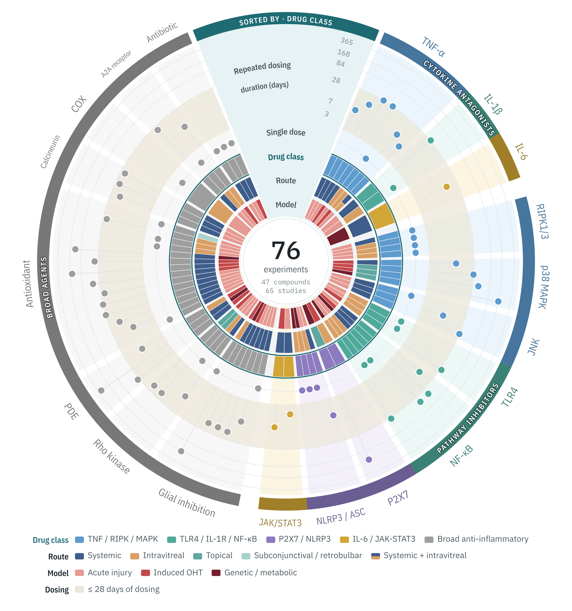

# RGC Neuroprotection Wheel

Interactive figure and curated dataset accompanying the review

> Malahov P, Bourdin A, Chabbi I, Delarasse C, Sennlaub F, Guillonneau X.
> *Pharmacological targeting of TNF-α, IL-1β and IL-6 signaling in retinal ganglion cell degeneration.* (under review)

**Open the wheel:** `index.html` (one self-contained file; works in any modern browser, also offline).
<!-- After publishing, replace with your links:
**Live version:** https://OWNER.github.io/rgc-neuroprotection-wheel/
**Archived version (DOI):** https://doi.org/10.5281/zenodo.XXXXXXX
-->



**Graphical abstract.** Preclinical testing of anti-inflammatory compounds in models of
retinal ganglion cell (RGC) degeneration. Each radial slice is one of the 76 in vivo
experiments summarized in Tables 1–3 (47 compounds, 65 studies), arranged by drug class
and grouped as cytokine antagonists, pathway inhibitors and broad agents. From the centre
outward, the rings show the injury model category, the route of administration and the
signalling pathway targeted (colours as in Figure 2); outer dots mark single-dose
experiments and the duration of repeated dosing (log scale; shaded band, ≤ 28 days).
Most experiments used acute injury models and short treatments.

## What the wheel shows

| Ring (inside → out) | Colour |
|---|---|
| Model | model category: acute injury, induced ocular hypertension (OHT), genetic / metabolic |
| Route | systemic, intravitreal, topical, subconjunctival / retrobulbar, systemic + intravitreal |
| Drug class | signalling pathway targeted (TNF / RIPK / MAPK, TLR4 / IL-1R / NF-κB, P2X7 / NLRP3, IL-6 / JAK-STAT3, broad anti-inflammatory) |
| Single dose | one dot per experiment given once |
| Repeated dosing | one dot per experiment at its treatment duration (log scale, 3–365 days) |

Every experiment keeps the same angle in all rings. In the interactive version you can
sort the wheel by drug class, route, injury model or dosing and duration (from the
sorting wedge at the top or the panel on the left), filter by any condition, hover a
segment to highlight the same experiments in every ring, and open each source study.

## Repository contents

| Path | What it is |
|---|---|
| `index.html` | The interactive wheel as one self-contained file (generated; do not edit) |
| `src/page.html` | Page text and structure; also opens directly as a live preview |
| `src/wheel.css` | Page styles and colour tokens (light and dark theme) |
| `src/settings.js` | Category colours and order, short labels, wheel sizes |
| `src/wheel.js` | Behaviour: filters, sorting, drawing, pop-ups |
| `data/RGC_wheel_source_data.xlsx` | Source data: *Experiments* (one row per experiment), *References*, *Drug classes*, and a *Summary* sheet whose formulas recompute every number quoted in the article |
| `data/data.json`, `data/data.js` | The rows drawn in the wheel, generated from the workbook |
| `scripts/prep.py` | Step 1: workbook → `data/data.json` and `data/data.js` |
| `scripts/build.py` | Step 2: `src/` + data + fonts → `index.html` |
| `scripts/render_graphical_abstract.py` | Step 3: `index.html` → `figure/` |
| `build_index.bat`, `render_figure.bat` | Double-click versions of steps 1–2 and step 3 on Windows |
| `figure/` | Graphical abstract: PNG and TIFF at 600 dpi (3900 × 4156 px, 16.5 × 17.6 cm) and vector PDF |
| `fonts/` | IBM Plex fonts (SIL Open Font License) |

## Editing and rebuilding

See **[EDITING.md](EDITING.md)** for what to change where. In short: edit the files in
`src/` (or the workbook), preview by opening `src/page.html`, then rebuild `index.html`:

```bash
pip install -r requirements.txt           # once
python3 scripts/prep.py                   # after editing the workbook
python3 scripts/build.py                  # writes index.html
python -m playwright install chromium     # once, for the figure
python3 scripts/render_graphical_abstract.py   # writes figure/ (options: --dpi, --width-in)
```

On Windows, double-click `build_index.bat` and `render_figure.bat` instead.

## Publishing

**GitHub Pages (live page).** Create a repository, upload the contents of this folder,
then in *Settings → Pages* choose *Deploy from a branch*, branch `main`, folder `/ (root)`.
The wheel appears at `https://OWNER.github.io/REPOSITORY/` within a few minutes.
GitHub Pages on a free account requires a public repository.

**Zenodo (permanent DOI).** Sign in to zenodo.org with GitHub, enable the repository under
*GitHub* in your Zenodo account, then create a release on GitHub (e.g. `v1.0.0`). Zenodo
archives that release with the metadata in `.zenodo.json` and issues a DOI. Cite the DOI
in the article; add it, the live link and the article reference to `CITATION.cff` and this
README for the next release.

**Other hosts.** `index.html` needs no server, database or external service, so a journal
(as an additional file) or an institutional website can host that single file unchanged.

## Checks for this version

- All 69 compound–reference pairs in Tables 1–3 (61 table rows) have an experiment row,
  every drawn row is in the tables, and the species of each table row match.
- Reference numbers, titles and DOIs match the manuscript reference list.
- The *Summary* sheet reproduces the counts in the text: 76 experiments, 47 compounds,
  65 studies, 62% acute injury models, 26 single-dose experiments, 69% of repeated-dose
  regimens ≤ 4 weeks. Genetic / metabolic models are 10 of 76 = 13.2% (13% in the text).
- Two curated rows are kept in the workbook but not drawn (In wheel = no): etanercept
  [56] in sonication-induced traumatic optic neuropathy (not in Table 1) and BIRB 796 [94]
  in squirrel monkeys (non-rodent arm, not in Table 2).
- Infliximab and adalimumab were removed from Table 1 and from this dataset: neither
  antibody has demonstrated cross-reactivity with rodent or rabbit TNF-α, so the
  reported effects cannot be attributed to TNF-α neutralisation. This removed four
  experiments (three studies, two compounds) from the previous version.

## Citation and licence

Please cite the article and this repository (`CITATION.cff`). Data, figures and page
content: CC BY 4.0 (`LICENSE-DATA.md`). Code: MIT (`LICENSE`). Fonts: SIL OFL 1.1.
